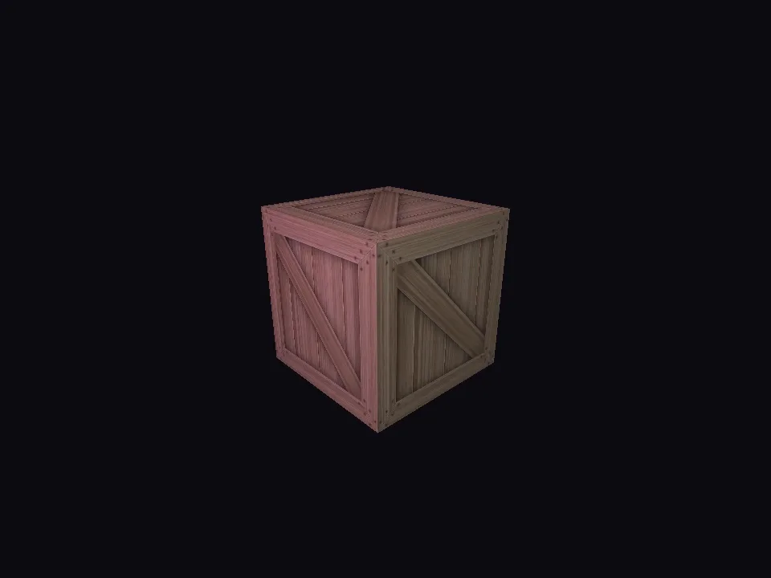

# Cámara y colisión con un cubo · C++ y OpenGL

Mantén **W** para acercarte a la caja de madera. La cámara se detiene al tocarla. Retrocede y muévete de lado para ver cómo cambia la iluminación sobre sus caras.



[Descargar para Windows x64](https://github.com/shaw207/cubo-opengl/releases/tag/v1.0.0) · Descomprime el ZIP y abre `CuboOpenGL.exe`. Necesitas un controlador compatible con OpenGL 3.3.

**WASD o flechas** para moverte, **ratón** para mirar y **Q / E** para subir o bajar. **0** apaga las dos luces, **1** las enciende y **Esc** cierra la escena.

<details>
<summary>Compilar en Windows</summary>

Con CMake 3.21 o posterior y Visual Studio 2022 con C++ x64, ejecuta estos comandos desde la raíz del proyecto.

```powershell
cmake -S . -B build -G "Visual Studio 17 2022" -A x64
cmake --build build --config Release
cmake --install build --config Release --prefix Windows
.\Windows\CuboOpenGL.exe
```

</details>

Chengxun Wu integró la cámara y la respuesta a la colisión en la sexta práctica de Programación Gráfica de U-tad. La textura de madera y la base de colisiones proceden del material docente. [Código de la cámara](src/Camera.cpp) · [Créditos y dependencias](THIRD-PARTY.txt)
